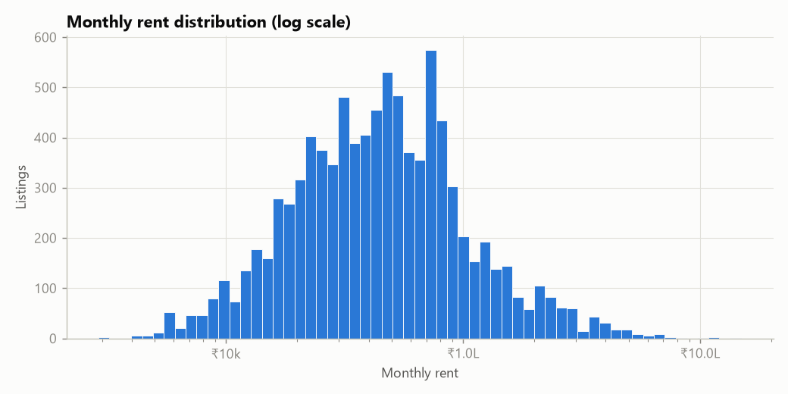
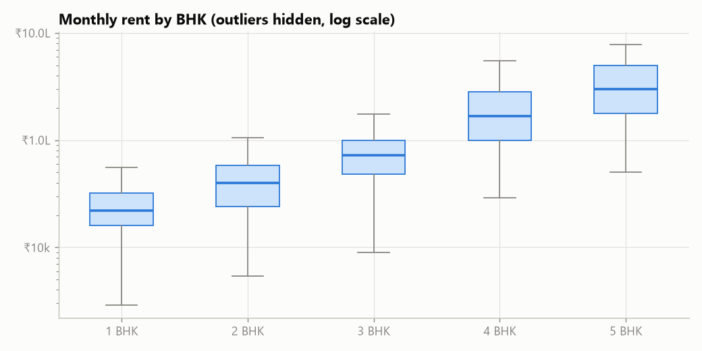
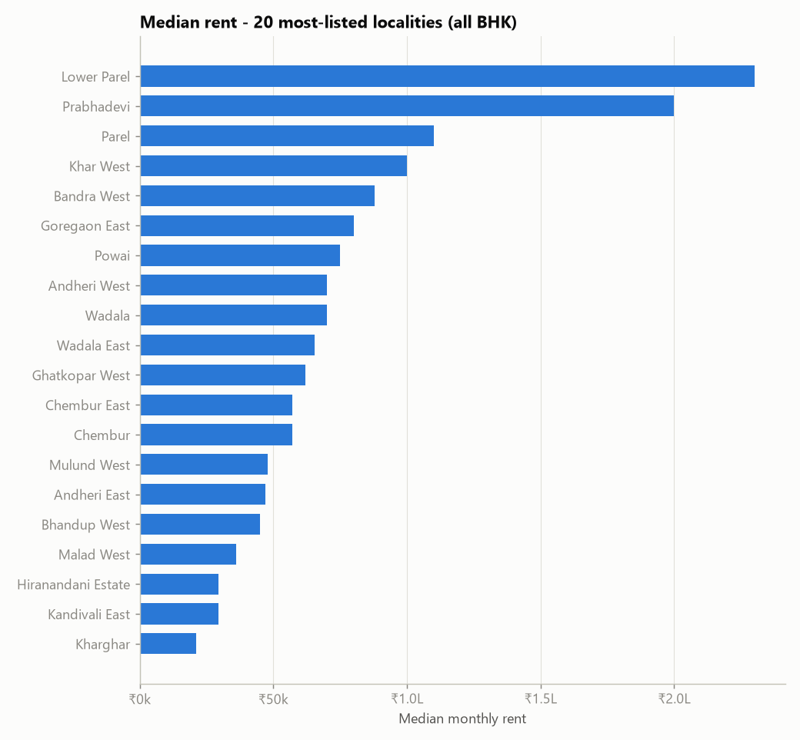
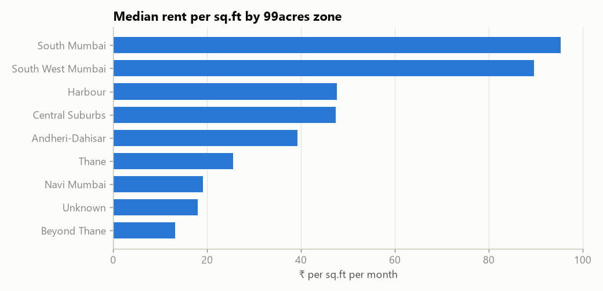
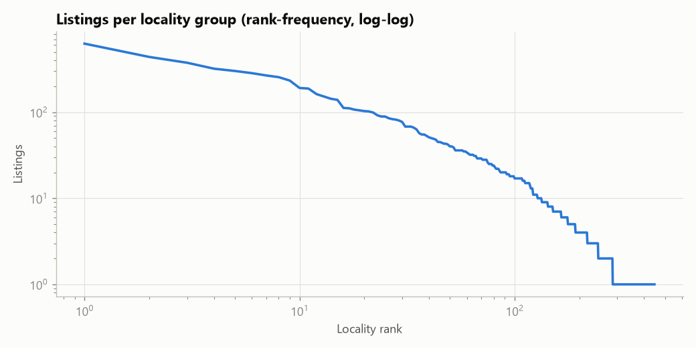
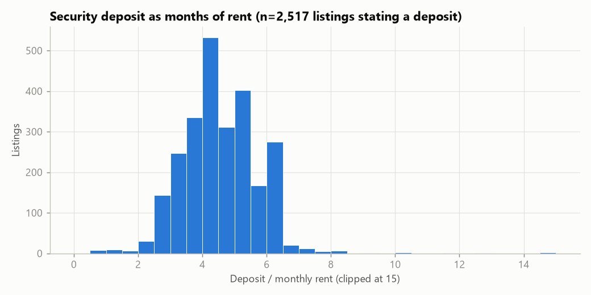
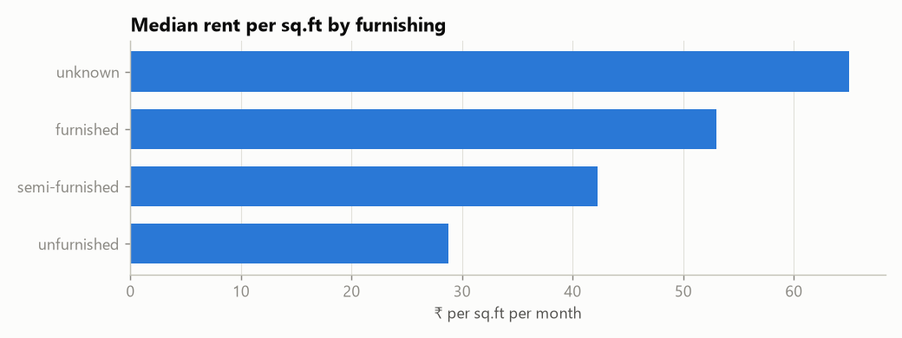
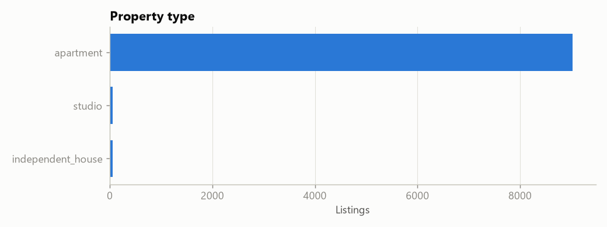
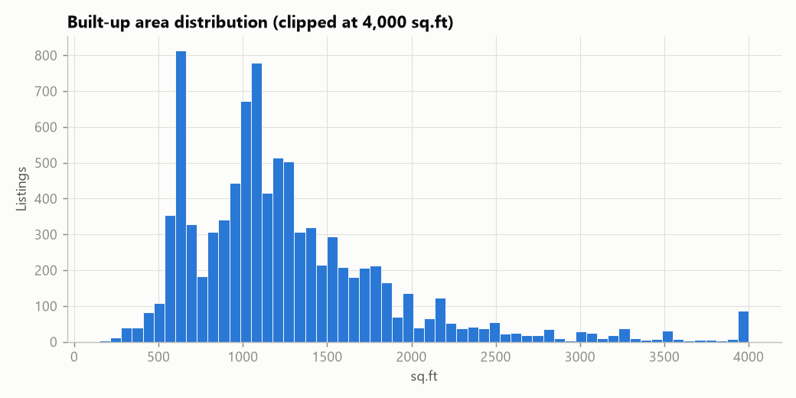

# EDA summary (auto-generated by `scripts/eda.py`)

Dataset: 9,139 cleaned listings (99acres Mumbai, July 2018). All figures below are computed from `data/processed/listings_clean.csv`.

## Rent
- Median monthly rent ₹45,000; IQR ₹25,000–₹75,000; 5th–95th percentile ₹11,190–₹200,000.
- Distribution is strongly right-skewed (skewness 4.8), so the price engine uses medians / log-scale statistics instead of means.
- Median rent by BHK: 1 BHK ₹22,000 (n=1745), 2 BHK ₹40,000 (n=4174), 3 BHK ₹72,000 (n=2680), 4 BHK ₹167,500 (n=484), 5 BHK ₹300,000 (n=48).
- Correlation between log(rent) and log(area): 0.66.

## Location
- 447 locality groups; only 91 have ≥20 listings and 256 have <5. The top 20 groups hold 50% of listings. This long tail is why the price engine falls back from locality → zone → city-wide peers.
- Median rent per sq.ft by zone: South Mumbai ₹95.37, South West Mumbai ₹89.66, Harbour ₹47.67, Central Suburbs ₹47.43, Andheri-Dahisar ₹39.29, Thane ₹25.54, Navi Mumbai ₹19.09, Unknown ₹18.07, Beyond Thane ₹13.24.

## Deposit
- A deposit could be parsed from the description for 2,517 listings.
- Median deposit = 4.4× monthly rent; IQR 3.7–5.2×; 95th percentile 6.0×; 99th percentile 7.1×.

## Furnishing, property type, area
- Median rent per sq.ft by furnishing: unknown ₹65.0 (n=189), furnished ₹53.0 (n=2121), semi-furnished ₹42.25 (n=4085), unfurnished ₹28.79 (n=2741).
- Property types: apartment 9,023, studio 61, independent_house 55.
- Median built-up area 1,125 sq.ft (5th–95th pct 565–2,500).

## Contacts and reposts
- 1,237 distinct (hashed) dealer contacts; median 4 listing(s) per contact, maximum 229. The top 10% of contacts account for 45% of listings.
- Implication: repeated contacts are *normal* for brokers in this market, so contact repetition is only a weak, informational signal in the risk engine.
- 467 cleaned listings had exact reposts in the raw file (max 69 copies).